## ⛔ LO MÁS IMPORTANTE — léelo cada sesión

| 🚦 | Regla |
|----|-------|
| 🎯 | **ESTO NO ES LA RUTINA DE HIPERTROFIA.** 4–6 reps al 80–87 % del 1RM. Si haces 8 reps, el peso está mal |
| ❌ | **NUNCA AL FALLO.** Terminas cada serie con 1–2 reps en reserva. El fallo aquí no suma, resta |
| ⚡ | **Concéntrica EXPLOSIVA, excéntrica controlada en 2–3 s.** La velocidad de subida es media de la adaptación neuromuscular |
| 🦴 | **Hombro: ya sin limitaciones.** Barra sobre la espalda permitida. Pero la **primera semana** prueba la posición con barra vacía: si se queja encima de la clavícula → safety bar, hack squat o prensa pesada |
| ⏰ | **48 h mínimo respecto a una sesión de calidad en bici.** Viernes funciona: jueves es umbral y el sábado es tirada Z2 + sweet spot |
| 🔥 | **Nunca cargues en frío.** Las series de aproximación de A1 no son opcionales |
| 🍗 | **1,6–2 g proteína/kg/día.** Multiplica por tu peso: a 70 kg son 115–140 g. Sin eso, la fuerza no sube |

> ✅ **El miedo de "me voy a poner grande" es infundado** (Cap. XX): la fuerza que hace un ciclista, combinada con el volumen de resistencia que haces, produce **menos hipertrofia** que la de quien solo va al gimnasio.

---

## 📈 El esquema de fuerza máxima en 5 líneas

1. **4–6 repeticiones al 80–87 % del 1RM**, 4–6 series en los ejercicios principales
2. **Descansos LARGOS: 2–3 min.** No son tiempo perdido, son parte del estímulo
3. ⚡ **Sube rápido, baja despacio.** Intención de velocidad máxima en la concéntrica
4. ✅ Las 5 reps salen limpias y con reserva en todas las series → **+2,5–5 kg la próxima sesión**
5. 🧠 Lo que buscas es **reclutar más fibra, no agrandarla**: pedalada más fuerte y más rápida, más resistencia a la fatiga

> ⚠️ **Dato que te da margen:** al dejar el entrenamiento de fuerza, las adaptaciones **se retienen más de 6 semanas**. No hay prisa y no se pierde en cuanto pares.

---

## 🔢 Cómo saber tu 1RM sin hacer un 1RM

No vas a hacer un máximo real: es innecesario y tiene riesgo. Estima:

| Reps que logras con un peso | Ese peso es ≈ |
|:---------------------------:|:-------------:|
| 10 reps | 75 % del 1RM |
| 8 reps | 80 % |
| 6 reps | 85 % |
| 5 reps | 87 % |
| 4 reps | 90 % |

**Cómo usarlo la primera sesión:** sube peso hasta encontrar el que mueves **6 reps dejando 1 en reserva**. Ese es tu 85 %. Divídelo entre 0,85 y tienes el 1RM estimado. **Apúntalo.**

> 📊 **Referencia orientativa:** una sentadilla de 1RM ≈ **1,3–1,5 × tu peso corporal** es un nivel sólido para un ciclista de resistencia. Si estás por debajo, aquí hay margen gratis de rendimiento.

---

# 🔥 CALENTAMIENTO *(10 min — obligatorio)*

| Orden | Qué | Dosis |
|:-----:|-----|-------|
| 1 | **Remo** (1ª opción), escaladora, elíptica o bici estática · suave · **ve rotando** | 5 min |
| 2 | Apertura de cadera 90/90 | 8 por lado |
| 3 | Sentadilla profunda sujetándote a un soporte | 10 reps |
| 4 | Puente de glúteo | 2 × 12 |
| 5 | **Aproximaciones de sentadilla** | barra vacía × 10 → 50 % × 5 → 70 % × 3 |

> ❌ **Correr NO vale como calentamiento aquí.** No tienes ni una carrera a pie en el histórico, y trotar es carga excéntrica de impacto que tus gemelos y tu Aquiles no han visto nunca. Además llegarías al rack con el sóleo ya fatigado, justo el músculo que entrenas en el ejercicio de tobillo. El remo calienta más masa muscular que la bici, sube más las pulsaciones y tiene **cero impacto**: esa es la mejora, no correr.

---

# 🏋️ BLOQUE 1 · Barra *(≈30 min)*

## A1 · Sentadilla trasera con barra ⭐ *el ejercicio central del bloque*

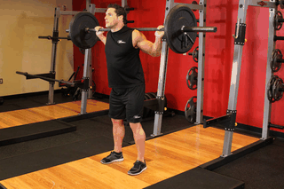

*Control de profundidad — sentadilla a banco. Úsala las primeras sesiones para calibrar hasta dónde bajar, y luego quita el banco:*

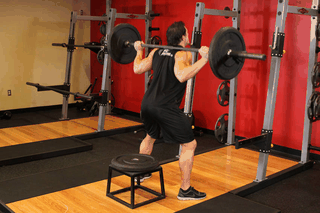

| Series | Reps | Descanso | Intensidad |
|:------:|:----:|:--------:|:----------:|
| **5** | **5** | ⏱️ **3 min** | **82–85 % 1RM** · reserva de 1–2 reps |

Barra sobre el trapecio (no sobre el cuello), pies al ancho de hombros, puntas ligeramente fuera. **Baja en 2–3 s** hasta que el muslo pase la paralela si tu movilidad lo permite, y **sube con toda la intención de velocidad que puedas**. Pecho alto, mirada al frente, rodillas siguiendo la línea de los pies.

> ⭐ **Es el ejercicio con más transferencia documentada al ciclismo.** El libro lo pone primero en las dos sesiones ejemplo. Los 3 min de descanso son los que permiten que la quinta serie pese igual que la primera: si descansas 90 s, estás haciendo otra cosa.
>
> 🔁 **Alternativas si el hombro molesta con la barra:** safety squat bar > hack squat > prensa 45° pesada a 5 reps. En ese orden.

## A2 · Peso muerto rumano ⭐ *la cadena posterior que el ciclismo no te da*

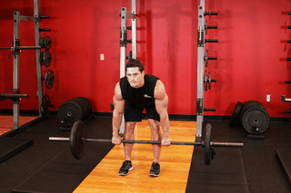

*La misma bisagra con la rodilla casi recta — peso muerto a piernas rígidas. Más tirón de isquio, menos carga tolerable:*

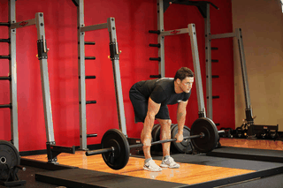

| Series | Reps | Descanso | Intensidad |
|:------:|:----:|:--------:|:----------:|
| **4** | **6** | ⏱️ **2–3 min** | **75–80 % 1RM** · reserva de 2 reps |

Barra pegada a las piernas, rodillas **ligeramente** flexionadas y fijas. **Bisagra de cadera:** lleva el culo atrás bajando la barra por el muslo hasta notar el tirón en el isquio (a media espinilla suele sobrar). Espalda **neutra todo el rato** — el momento en que se redondea, la serie ha terminado.

> ⚖️ **Por qué es imprescindible para ti:** el ciclismo desarrolla cuádriceps y deja el isquio y el glúteo atrás. Ese desequilibrio lo pagan la rodilla y la lumbar. Es el mismo argumento que el curl femoral de tu rutina vieja, pero con 5 veces más carga útil.

---

# 🦵 BLOQUE 2 · Máquinas y unilateral *(≈18 min)*

## A3 · Prensa 45° a UNA pierna ⭐ *unilateral: lo que pide el libro*

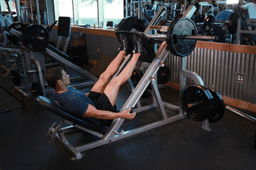

*Colocación de los pies — apoyo estrecho y centrado, que es el que replica el pedaleo:*

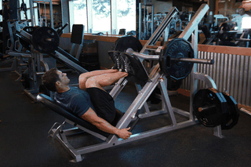

| Series | Reps | Descanso | Intensidad |
|:------:|:----:|:--------:|:----------:|
| **4** | **6 por pierna** | 2 min | **~80 % 1RM unilateral** |

Un pie en el centro de la plataforma, el otro apoyado fuera. Baja en 2–3 s hasta ~90° de rodilla sin despegar la lumbar y **empuja rápido** sin bloquear arriba. Haz las 6 de una pierna y pasa a la otra sin descanso entre lados.

> 💡 **Multiarticular + unilateral = exactamente lo que prescribe el Cap. XX.** Y replica el gesto real: pedaleas con una pierna a la vez. Además te dice si tienes asimetría, cosa que la bilateral esconde. **Manos en los agarres laterales.**

## A4 · Zancada caminando con mancuernas *(o subida al cajón)*

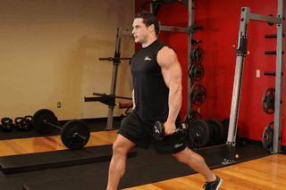

*El desplazamiento, sin peso, para ver el patrón antes de cargarlo:*

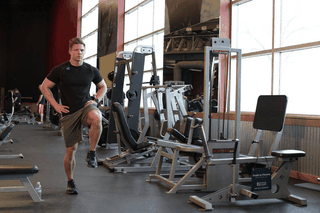

*Alternativa — subida al cajón con mancuernas:*

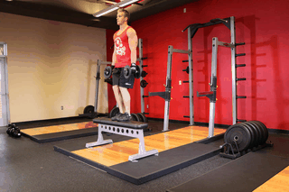

*Con barra, cuando las mancuernas se te queden cortas:*

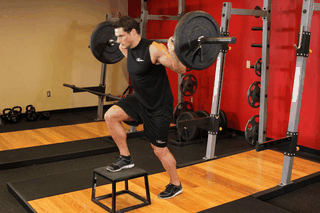

| Series | Reps | Descanso | Intensidad |
|:------:|:----:|:--------:|:----------:|
| **3** | **8 por pierna** | 90 s | Mancuernas · RPE 7, sin fallo |

Zancada larga, rodilla de atrás casi al suelo, torso vertical. Empuja con la pierna de delante para avanzar. **Alternativa equivalente:** subida al cajón (altura de la rodilla) con mancuernas, 8 por pierna — también está en la lista del libro.

> 💡 Patrón unilateral con componente de equilibrio y estabilidad de pelvis. Es el ejercicio que más se parece a subir de pie en una rampa.

## A5 · Dorsiflexión de tobillo en escalón *(o gemelos sentado)*

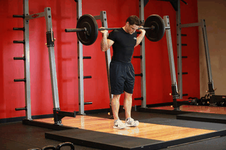

*Variante en máquina — gemelos sentado:*

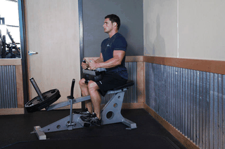

| Series | Reps | Descanso | Intensidad |
|:------:|:----:|:--------:|:----------:|
| **4** | **8–10** | 60 s | RPE 7–8 |

Puntas en el borde de un escalón, talones colgando. Baja hasta estirar bien el gemelo (2–3 s), sube al máximo y **aprieta 1 s arriba**. Con la máquina de gemelos sentado, igual: la almohadilla carga sobre la rodilla.

> 💡 **La dorsiflexión de tobillo está nombrada explícitamente en el protocolo del libro.** El tobillo transmite toda la fuerza al pedal: si cede, pierdes watts por el camino. El recorrido completo abajo es la mitad del beneficio.

---

# 🧘 BLOQUE 3 · Abdominal *(≈7 min)*

## A6 · Rodillo abdominal (ab wheel) *el único abdominal que prescribe el libro*

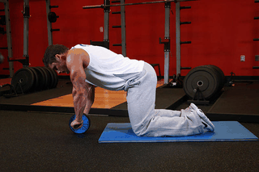

*Si no hay rodillo en la sala — rollout con barra y discos pequeños, de rodillas:*

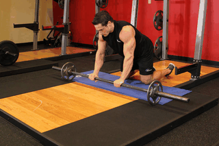

| Series | Reps | Descanso | Intensidad |
|:------:|:----:|:--------:|:----------:|
| **4** | **15** | 60 s | Rodillas en el suelo; de pie cuando sea fácil |

De rodillas, rodillo bajo los hombros, **lumbar en ligera retroversión**. Rueda hacia delante todo lo que puedas **sin que la cadera se hunda** y vuelve con el abdomen, no con los brazos.

> 💡 **Por qué este y no las planchas:** el Cap. XX es contundente — el trabajo de core en ciclistas **carece de evidencia sólida** y el único estudio disponible no mostró mejoras en ninguna duración de la curva de potencia. El libro mantiene solo el rodillo abdominal, 4 × 15, en sus dos sesiones ejemplo. Los compuestos (A1, A2) ya activan más el tronco que cualquier plancha.
>
> 🔁 **Si no hay rodillo:** flexión de cadera en polea o suspendido, 4 × 12 — trabaja el psoas, que el libro nombra como músculo asistente del pedaleo.

---

# 📋 Resumen — pégalo en el móvil

| # | Ejercicio | Series × Reps | % 1RM | Descanso |
|:-:|-----------|:-------------:|:-----:|:--------:|
| **A1** ⭐ | Sentadilla trasera con barra | 5 × 5 | **82–85 %** | **3 min** |
| **A2** ⭐ | Peso muerto rumano | 4 × 6 | 75–80 % | 2–3 min |
| **A3** ⭐ | Prensa 45° a una pierna | 4 × 6/pierna | ~80 % | 2 min |
| **A4** | Zancada caminando / subida al cajón | 3 × 8/pierna | RPE 7 | 90 s |
| **A5** | Dorsiflexión tobillo / gemelos | 4 × 8–10 | RPE 7–8 | 60 s |
| **A6** | Rodillo abdominal | 4 × 15 | — | 60 s |

**Total: 6 ejercicios, 24 series, ≈60 min.** Dentro del rango del libro (4–8 ejercicios, 4–6 series).

---

# 🗓️ Progresión del bloque (4 semanas)

| Semana | Fechas | Sentadilla A1 | Nota |
|:------:|--------|---------------|------|
| **S2** | 23–29 nov | 5 × 5 @ **80 %** | Semana de calibración. Encuentra los pesos y **apúntalos** |
| **S3** | 30 nov–6 dic | 5 × 5 @ **83 %** | +2,5–5 kg si S2 salió limpia |
| **S4** | 7–13 dic | 5 × 5 @ **85–87 %** | Pico de carga del bloque |
| **S5** | 14–20 dic | **3 × 4 @ 85 %** | 🔻 **DESCARGA.** Se mantiene la intensidad, se recorta el volumen |

- 📓 **Apunta kilos, series y reps de cada sesión.** Sin registro no hay progresión, solo improvisación
- ✅ 5 reps limpias con reserva en todas las series → **+2,5–5 kg**
- 🛑 Si la quinta serie se cae más de 1 rep respecto a la primera, el peso era excesivo: repite peso la semana siguiente
- 📅 **Después del 20 dic:** el bloque pasa a `r_mantenimiento_fuerza`, 1 sesión/semana. Las adaptaciones aguantan +6 semanas

---

*🎞️ Animaciones en la subcarpeta `videos/`, todas de [free-exercise-db](https://github.com/yuhonas/free-exercise-db) (dominio público). Los patrones con barra conviene verlos una vez con un entrenador de sala. Guía de entrenamiento — **no sustituye a tu fisio/traumatólogo**.*
