## ⛔ LO MÁS IMPORTANTE — léelo cada sesión

| 🚦 | Regla |
|----|-------|
| 🧠 | **POR QUÉ ESTA SESIÓN ES DE TREN SUPERIOR Y NO DE PIERNA.** El miércoles tienes VO2max el día antes y umbral el día después. Cargar pierna pesada ahí arruina las dos sesiones de calidad de la semana. Aquí el tren inferior descansa |
| 🦴 | **Hombro derecho: ya sin limitaciones.** Cargas plenas, rango completo, agarre libre. Se levantan las prohibiciones de la rutina vieja |
| 📏 | **Única restricción que mantengo:** elevaciones laterales no pasan de 90°, y press tras nuca **nunca** (eso no le conviene a ningún hombro) |
| 🔴 | **Dolor agudo encima de la clavícula** → para, baja peso o rango. Lleva 16 meses bien, pero el aviso se queda |
| 🎯 | **4–6 reps al 80 % en los compuestos** (B1, B2). Los compensatorios (B4, B5, B6) van a 10–12 reps: son postura, no fuerza máxima |
| 🔥 | **2 series al 50 %** antes de B1 y B2 |

---

## 📈 Para qué sirve exactamente esta sesión

El Cap. XX lo dice sin rodeos: hay que **compensar el patrón postural del ciclista** —flexión de columna y antepulsión escapular—, que es **el mismo patrón de un sedentario delante del ordenador**. Tú haces las dos cosas. A largo plazo eso genera desequilibrios reales.

Los ejercicios que el libro nombra para eso: **face pull, Y y T, extensión dorsal en banco, remo alto**. Están todos aquí.

> 💡 **No es trabajo "accesorio".** Es lo que te permite aguantar 5 horas sobre el manillar en marzo sin que se te bloquee la zona dorsal, y lo que sostiene el tronco cuando esprintas.

---

# 🔥 CALENTAMIENTO *(6 min)*

| Orden | Qué | Dosis |
|:-----:|-----|-------|
| 1 | Band pull-apart con goma | 2 × 15 |
| 2 | Dislocaciones de hombro con goma | 2 × 15 |
| 3 | Rotación torácica en cuadrupedia | 8 por lado |
| 4 | Rotación externa con goma, ligera | 1 × 20 por lado |

---

# 🏋️ BLOQUE 1 · Empuje y tracción *(≈22 min)*

## B1 · Press de hombro ⭐ *ahora con cargas plenas*

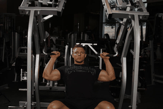

*La misma máquina en versión guiada, si en tu sala es la que hay:*

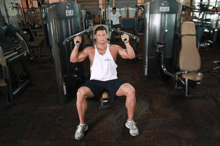

*Con barra y sentado, si quieres el patrón libre. Más exigente para el hombro: déjalo para cuando lleve semanas sin quejarse:*

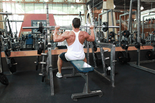

| Series | Reps | Descanso | Intensidad |
|:------:|:----:|:--------:|:----------:|
| **4** | **6** | ⏱️ **2 min** | **80 % 1RM** + 2 series al 50 % antes |

Máquina de palanca, mancuernas o barra — **ya puedes elegir**. Espalda firme, sube en 1–2 s **con intención de velocidad**, baja en 2–3 s. Rango completo: ya no hay que pararse a la altura de las orejas.

> ⭐ **Cambio respecto a tu rutina vieja:** antes eran 4 × 8 a RPE 7–8 buscando hipertrofia y con el rango limitado. Ahora son **4 × 6 al 80 %** y rango libre. Si llevas tiempo con la máquina, este es el momento de pasar a **mancuernas**: más demanda estabilizadora y más transferencia.

## B2 · Remo sentado en polea ⭐ *o remo con barra*

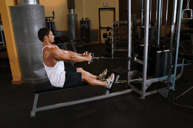

*La alternativa con barra que menciona el encabezado — remo inclinado:*

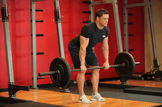

| Series | Reps | Descanso | Intensidad |
|:------:|:----:|:--------:|:----------:|
| **4** | **6** | ⏱️ **2 min** | **80 % 1RM** + 2 series al 50 % antes |

Pecho alto, tira llevando los **codos pegados al costado hacia atrás** y **junta las escápulas 1 s** al final. Vuelve en 2–3 s sin dejar que el hombro se vaya hacia delante. Cero balanceo de tronco.

> ⭐ **El antagonista directo de tu postura sobre la bici.** Cuatro horas en el manillar son cuatro horas de escápulas hacia delante. Esto las devuelve a su sitio con carga de verdad.

## B3 · Jalón al pecho en polea alta

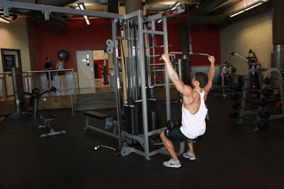

*Agarre estrecho: más recorrido de dorsal y menos apertura de hombro:*

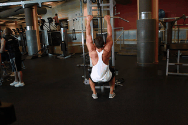

| Series | Reps | Descanso | Intensidad |
|:------:|:----:|:--------:|:----------:|
| **3** | **8** | 90 s | RPE 7–8 |

Agarre algo más ancho que los hombros, **pecho arriba**. Lleva la barra al pecho tirando con los dorsales, no con los brazos. Sube controlando en 3 s.

> 💡 Dorsal ancho: es lo que estabiliza el tronco contra el manillar cuando te levantas a esprintar. **Al pecho, nunca tras nuca.**

---

# 🧍 BLOQUE 2 · Compensatorio postural *(≈12 min)*

> ⚠️ **Estos tres van a 10–12 reps, no a 6.** Aquí no buscas fuerza máxima, buscas que el músculo postural trabaje y aguante. Peso moderado, ejecución impecable.

## B4 · Face pull con cuerda ⭐ *el mejor ejercicio de la sesión*

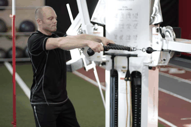

| Series | Reps | Descanso | Intensidad |
|:------:|:----:|:--------:|:----------:|
| **4** | **12** | 60 s | RPE 7 · pausa 1 s |

Polea a la altura de la cara. Tira hacia la **frente** separando las manos al final, **codos altos y atrás**. Junta las escápulas y aguanta 1 s.

> ⭐ **Deltoides posterior + romboides + manguito rotador en un solo movimiento,** y está nombrado literalmente en el Cap. XX como ejercicio compensatorio. Es el único que se mantiene intacto de tu rutina vieja. **Cero impulso con el tronco.**

## B5 · Y–T en banco inclinado *trapecio medio e inferior*

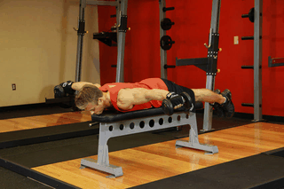

*Con la frente apoyada en el banco, que te quita toda la tentación de tirar con el tronco:*

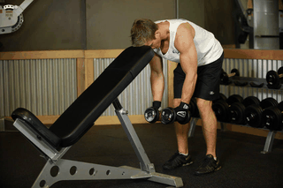

> 🎬 **Lo que ves en la animación es la T** (brazos en cruz) sobre banco plano. La **Y** es el mismo apoyo con los brazos subiendo en diagonal y los pulgares al techo. Usa el banco a 30–45°, no plano.

*Variante en máquina, solo válida para la T:*

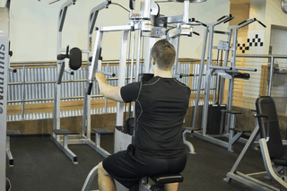

*La misma apertura en polea, de pie, si la máquina está ocupada:*

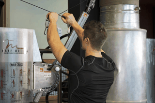

| Series | Reps | Descanso | Intensidad |
|:------:|:----:|:--------:|:----------:|
| **3** | **10 de cada letra** | 60 s | 🪶 **MUY ligero** (1–3 kg o sin peso) |

Tumbado boca abajo en banco a 30–45°, brazos colgando. **Y:** sube los brazos en diagonal hacia arriba formando una Y, pulgares al techo. **T:** ábrelos en cruz a la altura del hombro. 10 de cada una seguidas = 1 serie.

> 💡 **Trapecio medio e inferior, nombrados en el libro.** Son los músculos que fallan primero cuando llevas horas en posición aero. Aquí 2 kg se sienten como 20: si puedes con 5, lo estás haciendo con impulso. La alternativa en máquina (aperturas invertidas, la del gif) sirve para la T, pero no sustituye a la Y.

## B6 · Extensión dorsal en banco *extensores de columna*

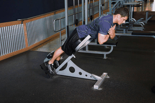

*Sin banco de lumbares, en el suelo. Menos recorrido, cero excusas:*

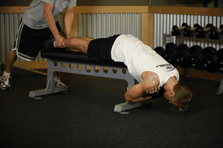

| Series | Reps | Descanso | Intensidad |
|:------:|:----:|:--------:|:----------:|
| **3** | **10** | 60 s | Disco al pecho, empieza con 5 kg |

Banco de hiperextensiones, cadera en el apoyo. Baja el tronco controlado y sube **hasta la línea del cuerpo, sin pasarte** (no hay que arquearse). Disco cruzado al pecho.

> 💡 **Extensores de columna, el tercer grupo que nombra el Cap. XX.** Es el músculo que te sostiene la espalda en las últimas dos horas de una gravel de 138 km. Sin carga no hace nada: disco desde el día 1.

---

# 🦵 BLOQUE 3 · Flexores de cadera *(≈5 min)*

## B7 · Flexión de cadera en polea *psoas-ilíaco*

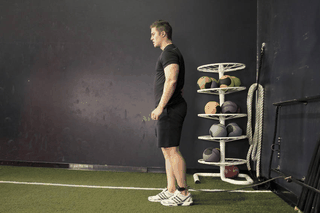

*La versión suspendida que nombra el libro — elevación de piernas colgado de la barra:*

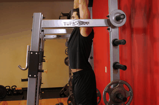

| Series | Reps | Descanso | Intensidad |
|:------:|:----:|:--------:|:----------:|
| **3** | **10 por lado** | 45 s | RPE 7 |

Tobillera de polea baja en el pie, de espaldas a la máquina. Lleva la rodilla al pecho contra la resistencia, controlando la vuelta. Alternativa: flexiones de tronco suspendido en barra.

> 💡 **El psoas-ilíaco es el músculo asistente del pedaleo que nombra el Cap. XX:** es el que tracciona del pedal en la fase de subida. Casi nadie lo entrena y es gratis. El libro apunta que también se puede incidir **sobre la bici, traccionando activamente del pedal** — pruébalo en los rodillos de Z2 del lunes.

---

# 📋 Resumen — pégalo en el móvil

| # | Ejercicio | Series × Reps | Intensidad | Descanso |
|:-:|-----------|:-------------:|:----------:|:--------:|
| **B1** ⭐ | Press de hombro | 4 × 6 | **80 % 1RM** | **2 min** |
| **B2** ⭐ | Remo sentado en polea | 4 × 6 | **80 % 1RM** | **2 min** |
| **B3** | Jalón al pecho | 3 × 8 | RPE 7–8 | 90 s |
| **B4** ⭐ | Face pull con cuerda | 4 × 12 | RPE 7 | 60 s |
| **B5** | Y–T en banco inclinado | 3 × 10+10 | 🪶 muy ligero | 60 s |
| **B6** | Extensión dorsal | 3 × 10 | + disco | 60 s |
| **B7** | Flexión de cadera en polea | 3 × 10/lado | RPE 7 | 45 s |

**Total: 7 ejercicios, 24 series, ≈45 min.**

---

# 🗓️ Progresión del bloque (4 semanas)

| Semana | Fechas | B1 y B2 | Nota |
|:------:|--------|---------|------|
| **S2** | 23–29 nov | 4 × 6 @ **78–80 %** | Calibración. **Apunta los kilos** |
| **S3** | 30 nov–6 dic | 4 × 6 @ **82 %** | +2,5 kg si S2 salió limpia |
| **S4** | 7–13 dic | 4 × 6 @ **85 %** | Pico del bloque |
| **S5** | 14–20 dic | **3 × 5 @ 82 %** | 🔻 Descarga. Compensatorios sin cambios |

- 📓 **Apunta los pesos.** 6 reps limpias con reserva → **+2,5 kg**
- 🪶 **B4, B5, B6 y B7 no progresan en kilos agresivamente.** Son postura: progresan en calidad de ejecución y en pausas más largas
- 📅 **Después del 20 dic:** pasa a `r_mantenimiento_fuerza`, 1 sesión/semana

---

*🎞️ Animaciones en la subcarpeta `videos/`, todas de [free-exercise-db](https://github.com/yuhonas/free-exercise-db) (dominio público). Los patrones con barra conviene verlos una vez con un entrenador de sala. Guía de entrenamiento — **no sustituye a tu fisio/traumatólogo**.*
