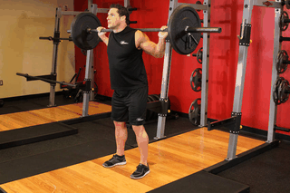
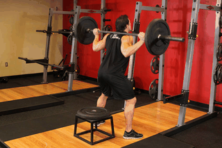
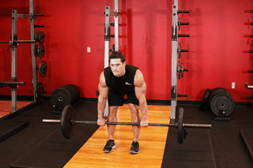
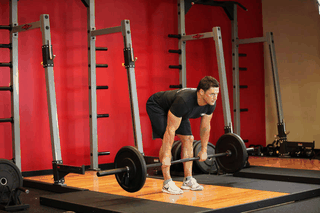
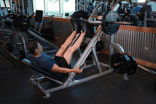
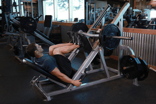
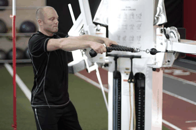
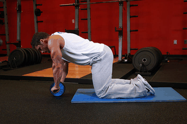
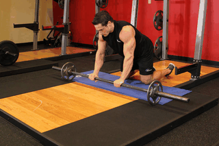

## ⛔ LO MÁS IMPORTANTE — léelo cada sesión

| 🚦 | Regla |
|----|-------|
| 🎯 | **ESTO NO BUSCA MEJORAR, BUSCA NO PERDER.** Menos volumen, misma o MÁS intensidad. Es la clave de todo mantenimiento |
| 📉 | **1 sesión semanal basta para retener** (Cap. XX, textual). Dos no te dan más y te quitan piernas para los intervalos |
| 🔼 | **2 × 5 reps al 88–90 % del 1RM.** Sí, más porcentaje que en el bloque de ganancia — porque son solo 2 series |
| ❌ | **NUNCA AL FALLO.** Aquí menos que nunca: esta sesión no puede costarte la del jueves |
| ⏰ | **Miércoles y nada más.** Martes es VO2max y jueves umbral: solo 2 series por ejercicio permiten meterla en medio sin daño |
| 🔥 | Calentamiento de 8 min y aproximaciones. Con 2 series al 90 % no hay margen para entrar en frío |

> ✅ **El dato que justifica esta rutina:** al cesar el entrenamiento de fuerza, **las adaptaciones se retienen de forma notoria durante más de 6 semanas**. No necesitas machacarte en enero para conservar lo de diciembre. Necesitas tocarlo una vez por semana.

---

## 📈 La lógica del mantenimiento en 3 líneas

1. **Lo que mantiene la fuerza es la INTENSIDAD, no el volumen.** Por eso suben los porcentajes y caen las series
2. **De 24 series semanales a 10.** Mismo estímulo neural, una fracción de la fatiga
3. 🚴 **A partir de aquí la bici manda.** El gimnasio pasa a ser el seguro que evita que pierdas lo construido, no el motor de la mejora

---

# 🔥 CALENTAMIENTO *(8 min)*

| Orden | Qué | Dosis |
|:-----:|-----|-------|
| 1 | **Remo** (1ª opción), escaladora, elíptica o bici estática · suave · **ve rotando** | 4 min |
| 2 | Apertura de cadera 90/90 + band pull-apart | 8/lado + 15 |
| 3 | **Aproximaciones de sentadilla** | barra vacía × 10 → 60 % × 5 → 80 % × 2 |


> ❌ **Correr NO vale como calentamiento aquí.** No tienes ni una carrera a pie en el histórico, y trotar es carga excéntrica de impacto que tus gemelos y tu Aquiles no han visto nunca. Además llegarías al rack con el sóleo ya fatigado, justo el músculo que entrenas en el ejercicio de tobillo. El remo calienta más masa muscular que la bici, sube más las pulsaciones y tiene **cero impacto**: esa es la mejora, no correr.

---

# 🏋️ LA SESIÓN *(≈22 min)*

## C1 · Sentadilla trasera con barra ⭐



*Recordatorio de profundidad — sentadilla a banco:*



| Series | Reps | Descanso | Intensidad |
|:------:|:----:|:--------:|:----------:|
| **2** | **5** | ⏱️ **3 min** | **88–90 % 1RM** · reserva de 1 rep |

Misma técnica que en `r_fuerza_max_inferior`: baja 2–3 s, **sube explosivo**. Con solo dos series, cada una cuenta: no te la juegues con la técnica.

> ⭐ **Es la sesión literal del libro:** *"Para retener (miércoles): los mismos ejercicios a 2 × 5 rep al 90 % 1RM + rodillo abdominal 2 × 15, seguido de 120' en Z2 de rodillo."*

## C2 · Peso muerto rumano



*Variante a piernas rígidas:*



| Series | Reps | Descanso | Intensidad |
|:------:|:----:|:--------:|:----------:|
| **2** | **5** | ⏱️ **2–3 min** | **85 % 1RM** |

Bisagra de cadera, espalda neutra, barra pegada a la pierna. En cuanto la lumbar se redondee, serie terminada.

> ⚖️ Mantiene el equilibrio cuádriceps–isquio que el ciclismo destruye por sí solo. Es el ejercicio que más barato te sale conservar.

## C3 · Prensa 45° a una pierna



*Apoyo estrecho y centrado:*



| Series | Reps | Descanso | Intensidad |
|:------:|:----:|:--------:|:----------:|
| **2** | **5 por pierna** | 2 min | **~85 % 1RM unilateral** |

Las 5 de una pierna, cambio sin descanso, 5 de la otra. **Manos en los agarres laterales.**

> 💡 El componente unilateral del libro. Aquí también vigilas asimetrías: si una pierna empieza a quedarse, lo ves antes de que se convierta en lesión.

## C4 · Face pull con cuerda ⭐



| Series | Reps | Descanso | Intensidad |
|:------:|:----:|:--------:|:----------:|
| **2** | **12** | 60 s | RPE 7 · pausa 1 s |

Codos altos y atrás, escápulas juntas 1 s.

> ⭐ **El único compensatorio que sobrevive al recorte,** y con razón: cuando empiece el volumen de carretera vas a pasar MÁS horas en el manillar, no menos. La antepulsión escapular se acumula justo en esta fase.

## C5 · Rodillo abdominal



*Si no hay rodillo — rollout con barra, de rodillas:*



| Series | Reps | Descanso | Intensidad |
|:------:|:----:|:--------:|:----------:|
| **2** | **15** | 60 s | Rodillas en el suelo |

> 💡 Tal cual lo prescribe el libro para la sesión de retención. Si no hay rodillo: flexión de cadera en polea 2 × 12.

---

# 📋 Resumen — pégalo en el móvil

| # | Ejercicio | Series × Reps | % 1RM | Descanso |
|:-:|-----------|:-------------:|:-----:|:--------:|
| **C1** ⭐ | Sentadilla trasera con barra | 2 × 5 | **88–90 %** | **3 min** |
| **C2** | Peso muerto rumano | 2 × 5 | 85 % | 2–3 min |
| **C3** | Prensa 45° a una pierna | 2 × 5/pierna | ~85 % | 2 min |
| **C4** ⭐ | Face pull con cuerda | 2 × 12 | RPE 7 | 60 s |
| **C5** | Rodillo abdominal | 2 × 15 | — | 60 s |

**Total: 5 ejercicios, 10 series, ≈30 min.** Frente a las 24 series del bloque de ganancia.

---

# 🗓️ Cómo encaja en la semana

```
LUN  Rodillo Z2 activo
MAR  CALIDAD 1 — VO2max
MIE  ESTA RUTINA (30 min) + rodillo Z2 después
JUE  CALIDAD 2 — Umbral
VIE  Rodaje suave o descanso
SAB  Tirada larga
DOM  Descanso
```

- 🚴 **Orden del miércoles: PRIMERO el gimnasio, después el rodillo Z2.** Nunca al revés: la fuerza con las piernas ya cargadas no da el estímulo y multiplica el riesgo
- 📓 **Sigue apuntando los kilos.** Si bajan dos semanas seguidas, no estás manteniendo: revisa sueño y comida antes de tocar la rutina
- 🏁 **Semana de competición:** se salta. Sin excepciones
- 🔁 **Si en algún momento vuelves a tener 2 huecos semanales**, recupera `r_fuerza_max_inferior` y `r_fuerza_max_superior`

---

*🎞️ Animaciones en la subcarpeta `videos/`, todas de [free-exercise-db](https://github.com/yuhonas/free-exercise-db) (dominio público). Los patrones con barra conviene verlos una vez con un entrenador de sala. Guía de entrenamiento — **no sustituye a tu fisio/traumatólogo**.*
